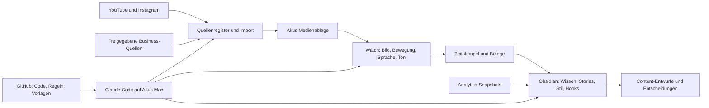

# Aku Second Brain – Mac / Claude Code

Ein übertragbarer Workflow für Akus Creator-Wissen und Kali Society. Das Repository enthält nur Werkzeuge, Regeln und leere Vorlagen. Videos, Transkripte, Analytics und Kundeninformationen entstehen erst in Akus eigener Umgebung.

**Stand: Starter-Paket, kein bereits befülltes Second Brain.** Die lokale Einrichtung, Videoaufbereitung und Prüfung der dokumentierten Zeitabdeckung sind ausführbarer Python-Code. Inhaltliche Analyse und Vault-Pflege werden durch die beigefügten Claude-Code-Skills angeleitet. Account-Anbindungen, ein audio-/videofähiger Analyseweg und optionaler Cloud-Sync müssen bei Aku eingerichtet werden; es gibt dafür noch keinen fertigen OAuth-Connector oder Hintergrunddienst.

## Start für Aku

Die kurze Anleitung zum direkten Weitergeben steht in [START-HIER.md](START-HIER.md).

1. Das öffentliche Repository auf Akos Mac klonen – oder über **Code → Download ZIP** herunterladen und entpacken. Keine Einladung erforderlich. Repository: [akiotaota-star/aku-second-brain](https://github.com/akiotaota-star/aku-second-brain).
2. [Claude Code](https://code.claude.com/docs/en/setup), Python 3 und Obsidian bereitstellen. Für Videoaufbereitung zusätzlich FFmpeg; weitere Abhängigkeiten siehe [Setup](docs/SETUP.md).
3. Im Repository-Ordner `claude` starten und **`/brain-setup`** eingeben.
4. Claude fragt **Schritt für Schritt jeweils die nächste Information** ab: Speicherort, Datenverarbeitung, Account-URLs, Google-Drive-Ordner, vorhandene und bereits verwendete Skripte, Originalvideos, Analytics und Kali-Society-Unterlagen. Vorhandene Antworten werden gespeichert; fehlendes Material kann ausdrücklich auf später verschoben werden. Die Namen „Aku Kali“ allein identifizieren die Accounts nicht zuverlässig.
5. Den erzeugten Ordner `vault` in Obsidian als vorhandenen Vault öffnen. Erst drei Videos vollständig prüfen, danach den gesamten Katalog abarbeiten.

Paste-Prompt für den ersten Start:

> Starte /brain-setup und führe mich nach docs/ONBOARDING.md Schritt für Schritt durch die Einrichtung meines Second Brain. Stelle immer nur die nächste konkrete Frage und warte auf meine Antwort. Sag mir jeweils genau, welche Videos, Google-Drive-Dateien, bereits geschriebenen oder verwendeten Skripte und Business-Unterlagen du brauchst und wo ich sie auf meinem Mac bereitstelle. Halte meine Inhalte außerhalb dieses Repositories. Prüfe echte Audio- und Videosichtung an drei Pilotvideos, bevor du das gesamte Archiv verarbeitest. Markiere fehlende Fähigkeiten und Materialien offen.

## Das System



Obsidian ist das lesbare Gedächtnis. Die Originalmedien und ausführlichen Sekundenprotokolle liegen daneben. Claude sucht zuerst passende Notizen und Belege; es muss nicht bei jeder Frage alle Videos erneut sehen.

## Akus Datenordner

```text
AkuBrain/                         # separat vom GitHub-Repository
├── vault/                        # in Obsidian öffnen
│   ├── 00_Start/
│   ├── 01_Inbox/
│   ├── 02_Quellen/                # eine Notiz je Video/Quelle
│   ├── 03_Wissen/                 # einzelne belegte Erkenntnisse
│   ├── 04_Stories/                # Erlebnisse, Versionen, Aussagen
│   ├── 05_Stil/                   # Redeart, Ton, Gestik, Editing
│   ├── 06_Hooks/
│   ├── 07_Performance/
│   ├── 08_Kali_Society/           # Angebote, Abläufe, Entscheidungen
│   ├── 09_Content_Studio/         # Skripte, Ideen, Briefings
│   ├── 10_Reviews/
│   └── 99_Templates/
├── private-vault/                # Kunden, Gespräche, private Zuordnungen
├── media/                        # Originale mit stabiler Quellen-ID
├── inbox/                        # Videos, Skripte, Drive, Analytics, Business
├── system/config.json            # Speicher-/Provider-/Account-Konfiguration
├── system/onboarding.json        # Fortschritt des schrittweisen Dialogs
└── work/                         # Jobs, Transkripte, Clips, Caches, Modelle
```

Der private Vault lässt Kundenwissen Teil des Systems sein, ohne es standardmäßig in jede Content-Aufgabe einzubeziehen. Ein Ordner allein erzwingt keine Zugriffsrechte. Er wird vom Launcher nicht als zusätzlicher Arbeitsbereich hinzugefügt; der erlaubte Zugriff muss bei sensiblen Aufgaben passend konfiguriert werden.

## Bedienung nach der Einrichtung

| Einstieg | Ergebnis |
|---|---|
| `/brain-setup` | Geführte Einrichtung einschließlich Drive, Skripten, Videoquellen und Pilot |
| `/watch` | Ein konkretes Video mit nachgewiesener Zeitabdeckung analysieren |
| `/brain-update` | Katalog abgleichen, neue Quellen bearbeiten, Kennzahlen ergänzen |
| `/brain-use` | Fragen beantworten, Wissen erfassen oder Content aus belegten Mustern entwerfen |

Diese Slash-Befehle sind Projekt-Skills und werden bei lokalem Claude Code aus `.claude/skills/` geladen. Sie sind keine dauerhaft laufenden Dienste. [Claude-Code-Dokumentation](https://code.claude.com/docs/en/skills)

## Was „jede Sekunde“ bedeutet

Jede Sekunde bekommt einen Eintrag mit Sprache, Bild/Text, Gestik, Ton, Editing und Belegen. Ein Bild pro Sekunde ist eine Orientierungshilfe. Für Gestik, kurze Einblendungen, Tonfall und Übergänge müssen zusammenhängende Clips und das echte Audio geprüft werden. Fehlt dafür ein geeignetes Tool oder eine Sichtung, bleibt die Modalität offen. Siehe [Analysestandard](docs/ANALYSESTANDARD.md).

Views sind keine Messung einer einzelnen Geste. Kennzahlen erhalten Erfassungszeitpunkt, Plattform und Definition. YouTubes Retention-API liefert 100 relative Zeitpunkte pro Video; bei langen Videos sind das keine Sekundenwerte. [YouTube-Dokumentation](https://developers.google.com/youtube/analytics/dimensions#elapsedVideoTimeRatio)

## Was hier nicht mitgeliefert wird

Keine Akus Videos, Instagram-Exports, Kundendaten, Zugangsdaten oder erfundenen Analysen. Keine automatische Synchronisierung, keine kostenpflichtigen Modellaufrufe und keine vollständige Offline-KI. Die Skripte selbst rufen keine Netzwerke auf. Claude Code verwendet einen Modellanbieter; Inhalte, die es liest und zur Analyse verwendet, können Teil der Modellanfragen werden. Lokale Ablage und Verarbeitung durch einen Anbieter sind getrennte Entscheidungen. [Claude Code: Security](https://code.claude.com/docs/en/security), [Data usage](https://code.claude.com/docs/en/data-usage)

Weitere Details: [Einrichtung](docs/SETUP.md) · [Gesamtablauf](docs/WORKFLOW.md) · [Datenformate](docs/DATENMODELL.md) · [Quellen und Grenzen](docs/QUELLEN.md) · [Validierung](docs/VALIDIERUNG.md)

Dialogablauf und konkrete Materialfragen: [Schritt-für-Schritt-Onboarding](docs/ONBOARDING.md).
